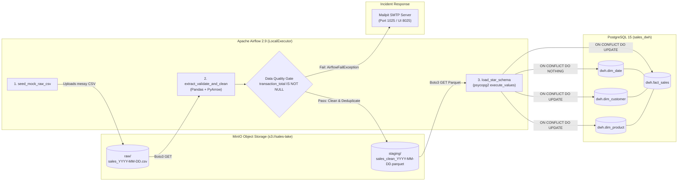
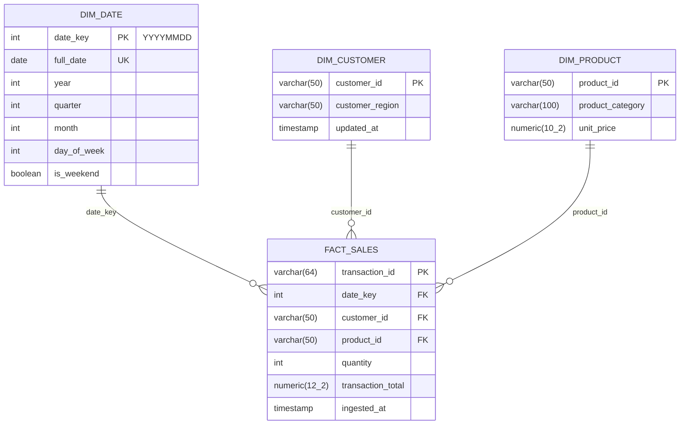

# Automated Retail Sales ETL & Kimball Star Schema Pipeline


An idempotent, containerized batch ETL pipeline orchestrated with Apache Airflow. The system extracts unvalidated daily sales dumps from S3-compatible object storage (MinIO), enforces strict circuit-breaker data quality checks, normalizes inconsistent date and string formats into columnar Parquet staging files, and performs idempotent upserts into an OLAP-indexed PostgreSQL Kimball star schema.

---

## System Architecture

GitHub natively renders the Mermaid diagram below. It illustrates the data flow across the isolated Docker network, separating the happy-path staging and warehouse load from the circuit-breaker alerting path.



---

## Engineering Decisions & Architecture Rationale

Many portfolio pipelines pass DataFrames directly between Airflow tasks and execute raw SQL `INSERT` statements. That approach collapses under production load. This repository addresses four failure modes common in batch data engineering:

| Architectural Challenge | Naive Implementation | Production Pattern Implemented Here |
| :--- | :--- | :--- |
| **Inter-Task Data Transfer** | Passing Pandas DataFrames via Airflow XComs, which serializes data into the Airflow metadata DB and crashes the scheduler as volume grows. | Tasks pass **only S3 object keys** via XCom. Intermediate datasets are written to `s3://sales-lake/staging/` as Snappy-compressed **Apache Parquet** files, preserving schema types and keeping the metadata DB lean. |
| **Backfill Idempotency** | Running bare `INSERT INTO` statements, causing duplicate revenue rows whenever a historical DAG run is cleared and re-executed. | Every dimension and fact load uses `psycopg2.extras.execute_values` with explicit **`ON CONFLICT (...) DO UPDATE`** clauses. Re-running any historical date overwrites existing records deterministically without duplicating transactions. |
| **Corrupted Upstream Data** | Allowing `NULL` financial metrics to propagate into the warehouse or wasting compute retrying deterministic data errors. | A hard **circuit-breaker quality gate** inspects `transaction_total` before transformation. If nulls exist, the task raises `AirflowFailException` (bypassing retries) and triggers an `on_failure_callback` that sends an HTML incident payload with the offending `transaction_id` list via SMTP. |
| **OLAP vs. Metadata Contention** | Storing analytical tables inside Airflow's default `airflow` database. | `init_dwh.sql` provisions a dedicated `sales_dwh` database and `dwh` schema on first boot, complete with B-Tree indexes on foreign keys (`date_key`, `customer_id`, `product_id`) for fast star-join aggregations. |

---

## Star Schema Data Model (`sales_dwh.dwh`)



---

## Repository Structure

```text
sales-etl-pipeline/
├── docker-compose.yml               # Multi-container orchestration (Airflow, Postgres, MinIO, Mailpit)
├── dags/
│   └── sales_star_schema_etl.py     # TaskFlow API DAG: extraction, quality gate, Parquet staging, upsert
├── sql/
│   └── init_dwh.sql                 # Automated DDL provisioning sales_dwh, star schema tables, and indexes
├── logs/                            # Bind-mounted Airflow task execution logs
└── README.md
```

---

## Quick Start & Local Deployment

### Prerequisites
* **Docker Engine** and **Docker Compose v2** (allocate at least 4 GB RAM to Docker Desktop).
* Ports `5432`, `8025`, `8080`, `9000`, and `9001` free on `localhost`.

### 1. Clone and Initialize the Stack
```bash
git clone [https://github.com/](https://github.com/)<your-username>/sales-etl-pipeline.git
cd sales-etl-pipeline
mkdir -p logs && chmod -R 777 logs
docker compose up -d
```
Wait ~45 seconds for `airflow-init` to complete database migrations and user creation. Verify all services report `healthy` or `Up`:
```bash
docker compose ps
```

### 2. Service Endpoints & Credentials

| Service | Local URL | Username | Password | Purpose |
| :--- | :--- | :--- | :--- | :--- |
| **Airflow Web UI** | `http://localhost:8080` | `admin` | `admin` | Trigger DAG runs and inspect task logs |
| **MinIO Console** | `http://localhost:9001` | `minioadmin` | `minioadmin` | Browse `s3://sales-lake/raw/` and `staging/` |
| **Mailpit Web UI** | `http://localhost:8025` | *(None)* | *(None)* | Inspect captured SMTP failure alert emails |
| **PostgreSQL DWH** | `localhost:5432` (`sales_dwh`) | `airflow` | `airflow` | Run OLAP SQL queries against `dwh.*` |

---

## Verification Scenarios

### Scenario A: Clean Execution & Idempotency Verification
1. Open `http://localhost:8080`, unpause `sales_star_schema_etl` if paused, and click **Trigger DAG**.
2. Once all three tasks turn dark green, verify that the duplicate row (`TXN-1001`) and mixed date formats (`2026/10/15`, `15-10-2026`, `Oct 15 2026`) were normalized and loaded into PostgreSQL:
```bash
docker compose exec postgres psql -U airflow -d sales_dwh -c "
SELECT
    d.full_date,
    c.customer_region,
    p.product_category,
    COUNT(f.transaction_id) AS txn_count,
    SUM(f.transaction_total) AS total_revenue
FROM dwh.fact_sales f
JOIN dwh.dim_date d     ON f.date_key = d.date_key
JOIN dwh.dim_customer c ON f.customer_id = c.customer_id
JOIN dwh.dim_product p  ON f.product_id = p.product_id
GROUP BY 1, 2, 3
ORDER BY total_revenue DESC;"
```
3. Trigger the DAG a second time. Re-run the SQL query above to confirm `txn_count` and `total_revenue` remain identical, proving pipeline idempotency.

### Scenario B: Circuit-Breaker Quality Gate & SMTP Alerting
1. In the Airflow UI, click the **Play** dropdown on `sales_star_schema_etl` and select **Trigger DAG w/ config**.
2. Pass the following runtime parameter to inject a `NULL` value into `transaction_total` for transaction `TXN-1003`:
```json
{"inject_bad_data": true}
```
3. Observe `extract_validate_and_clean` transition immediately to `failed` (zero retries wasted) and `load_star_schema` halt with status `upstream_failed`.
4. Open `http://localhost:8025` (Mailpit) to view the `[CRITICAL] Data Quality Gate Failed` alert email containing the execution date, S3 bucket URI, and offending transaction ID (`['TXN-1003']`).

---

## Teardown
To stop the containers while preserving your warehouse data and MinIO objects:
```bash
docker compose stop
```
To destroy all containers, networks, and database volumes completely:
```bash
docker compose down -v
```
